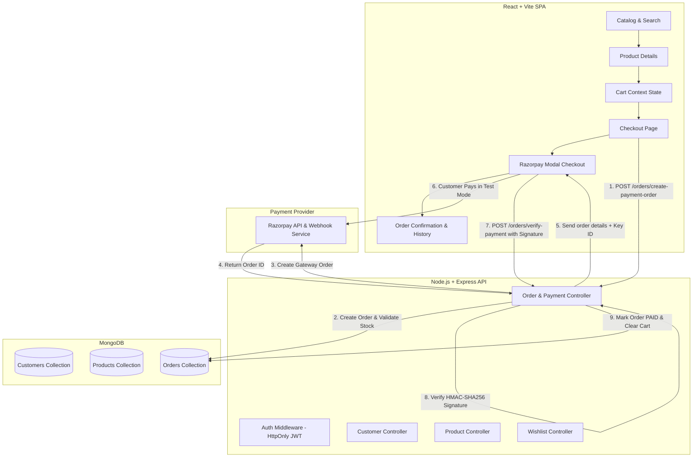

# 🛒 ShopKart — Full-Stack E-Commerce Platform

> A production-grade, full-stack MERN e-commerce application built with **React, Node.js, Express, MongoDB, and Razorpay Test Payment Integration**.

---

## 📌 Table of Contents
- [Project Overview](#-project-overview)
- [System Architecture](#-system-architecture)
- [Key Features](#-key-features)
- [Tech Stack](#-tech-stack)
- [Folder Structure](#-folder-structure)
- [Installation & Setup](#-installation--setup)
- [Environment Variables](#-environment-variables)
- [API Documentation](#-api-documentation)
- [Razorpay Payment Flow & Security](#-razorpay-payment-flow--security)
- [Automated Testing](#-automated-testing)
- [Engineering Principles Implemented](#-engineering-principles-implemented)

---

## 🌟 Project Overview

**ShopKart** is an end-to-end e-commerce platform that implements the complete shopping lifecycle:
1. **Authentication**: Secure customer signup, login, and profile management using **JWT stored in HttpOnly cookies** and **bcrypt** password hashing.
2. **Product Catalog**: Live search, multi-category filtering, dynamic price sorting, and inventory tracking.
3. **Wishlist**: Per-user persisted wishlist with toggle add/remove functionality.
4. **Shopping Cart**: Real-time state management using React Context API with inventory limit checks.
5. **Checkout & Orders**: Multi-step checkout with address validation, server-side stock verification, and purchase-time **price snapshotting**.
6. **Payment Gateway**: Seamless **Razorpay Test Mode** integration featuring mandatory **HMAC-SHA256 server-side cryptographic signature verification**.
7. **Order Management**: Real-time order placement, automatic cart clearing on verified payment, order receipt confirmation, and historical order tracking.

---

## 🏗️ System Architecture



---

## 🚀 Key Features

### 🔐 1. Customer Authentication (Labs 01 & 02)
- Custom authentication without third-party black-box libraries (no Passport/Auth0).
- Passwords hashed with `bcryptjs` (salt rounds = 10).
- Stateless authentication using JSON Web Tokens (JWT) stored in secure `HttpOnly`, `SameSite` cookies to prevent XSS attacks.
- Protected profile fetching (`GET /customers/profile`) and secure password updates (`PUT /customers/change-password`).

### 📦 2. Product Catalog, Search & Filtering (Lab 03)
- Keyword search across product name and description using MongoDB `$regex`.
- Category-based filtering and multi-criteria sorting (Price Low-to-High, High-to-Low, Newest).
- Real-time stock status display with out-of-stock badges.

### ❤️ 3. Wishlist Service (Lab 04)
- User-specific wishlist persisted in MongoDB via Mongoose object references.
- One-click toggle add/remove with duplicate protection.
- Instant UI synchronization across catalog and product pages.

### 🛍️ 4. Shopping Cart & Global State (Lab 05)
- React Context API managing cart items across page reloads.
- Quantity increment and decrement bounded by live product inventory limits.
- Real-time subtotal, shipping, and tax calculations.

### 💳 5. Checkout & Razorpay Payment Integration (Lab 06)
- **Multi-Step Checkout**: Shipping address validation, review summary, and instant order creation.
- **Stock Re-verification**: Server checks stock availability before initiating payment to prevent race conditions.
- **Price & Title Snapshotting**: Captures exact product name, price, and thumbnail at purchase time, ensuring historical orders are immune to future catalog price changes.
- **HMAC-SHA256 Signature Verification**: Eliminates payment spoofing by cryptographically matching the signature generated from `razorpay_order_id + "|" + razorpay_payment_id` using the secret key.
- **Cart Reset**: Cart is only wiped once the payment signature has been cryptographically confirmed by the server.
- **Order Tracking**: Detailed receipt view (`/orders/:id`) and complete order history (`/orders`).

---

## 💻 Tech Stack

| Layer | Technologies |
|---|---|
| **Frontend** | React 18, Vite, Tailwind CSS, React Router DOM v6, Lucide React Icons |
| **Backend** | Node.js, Express.js |
| **Database** | MongoDB, Mongoose ODM |
| **Security & Auth** | JSON Web Tokens (`jsonwebtoken`), `bcryptjs`, `cookie-parser`, `crypto` |
| **Payment Gateway** | Razorpay Node SDK (Test Mode) |
| **Testing** | Jest, Supertest |

---

## 📁 Folder Structure

```text
ShopKart/
├── backend/
│   ├── config/
│   │   └── db.js                        # MongoDB Mongoose connection
│   ├── controllers/
│   │   ├── customer.controller.js       # Auth & profile business logic
│   │   ├── product.controller.js        # Catalog search & filtering logic
│   │   ├── wishlist.controller.js       # Wishlist add/remove logic
│   │   └── order.controller.js          # Order creation & signature verification
│   ├── middlewares/
│   │   └── auth.middleware.js           # JWT verification & req.user injection
│   ├── models/
│   │   ├── customer.model.js            # Customer schema with bcrypt hooks
│   │   ├── product.model.js             # Product catalog schema
│   │   └── order.model.js               # Order schema with snapshot items
│   ├── routes/
│   │   ├── customer.routes.js           # /customers routes
│   │   ├── product.routes.js            # /products routes
│   │   ├── wishlist.routes.js           # /wishlist routes
│   │   └── order.routes.js              # /orders routes
│   ├── test/                            # Jest + Supertest automated suites
│   ├── utils/
│   │   └── generateToken.js             # JWT signer & cookie configuration
│   ├── .env                             # Backend environment variables
│   ├── index.js                         # Express entrypoint
│   └── package.json
│
├── frontend/
│   ├── src/
│   │   ├── components/
│   │   │   ├── Navbar.jsx               # Navigation bar with live cart/wishlist counts
│   │   │   ├── ProductCard.jsx          # Catalog card with quick actions
│   │   │   ├── RazorpayModal.jsx        # Test mode checkout modal
│   │   │   └── ProtectedRoute.jsx       # Route guard for authenticated users
│   │   ├── context/
│   │   │   ├── AuthContext.jsx          # Global auth state & user session
│   │   │   └── CartContext.jsx          # Global cart state & actions
│   │   ├── pages/
│   │   │   ├── Home.jsx                 # Catalog, search, filters & banner
│   │   │   ├── ProductDetails.jsx       # Detailed product view & stock display
│   │   │   ├── Cart.jsx                 # Shopping cart summary & quantity controls
│   │   │   ├── Checkout.jsx             # Address entry & payment initialization
│   │   │   ├── OrderDetails.jsx         # Order receipt & confirmation page
│   │   │   ├── Orders.jsx               # User order history
│   │   │   ├── Wishlist.jsx             # Saved items
│   │   │   ├── Login.jsx                # Customer login
│   │   │   └── Register.jsx             # Customer registration
│   │   ├── App.jsx                      # Route configurations
│   │   └── main.jsx
│   ├── package.json
│   └── vite.config.js
│
└── README.md
```

---

## ⚙️ Installation & Setup

### Prerequisites
- **Node.js** (v18.x or higher)
- **MongoDB** running locally (`mongodb://127.0.0.1:27017`) or a MongoDB Atlas URI
- **Git**

### 1. Clone the Repository
```bash
git clone <repository-url>
cd "Engineering Lab"
```

### 2. Backend Setup
```bash
cd backend
npm install
```

Create a `.env` file inside `backend/` (see [Environment Variables](#-environment-variables)):
```bash
npm run dev
# Server running on http://localhost:5000
```

### 3. Frontend Setup
Open a new terminal window:
```bash
cd frontend
npm install
npm run dev
# Frontend running on http://localhost:5173
```

---

## 🔑 Environment Variables

### Backend (`backend/.env`)
```env
PORT=5000
NODE_ENV=development
MONGO_URI=mongodb://127.0.0.1:27017/shopkart
JWT_SECRET=shopkart_super_secret_jwt_key_2026

# Razorpay Test Mode Credentials
RAZORPAY_KEY_ID=rzp_test_YourKeyHere
RAZORPAY_KEY_SECRET=YourSecretKeyHere
```
*(Note: If no Razorpay keys are provided, the application runs seamlessly in Mock Sandbox mode for instant evaluation).*

### Frontend (`frontend/.env` - optional)
```env
VITE_API_BASE_URL=http://localhost:5000
```

---

## 📡 API Documentation

### 👤 Customer Authentication (`/customers`)
| Method | Endpoint | Access | Description |
|---|---|---|---|
| `POST` | `/customers/register` | Public | Register a new customer (`name`, `email`, `password`) |
| `POST` | `/customers/login` | Public | Login customer and issue HttpOnly JWT cookie |
| `POST` | `/customers/logout` | Public | Clear authentication cookie |
| `GET` | `/customers/profile` | Protected | Fetch current logged-in customer profile |
| `PUT` | `/customers/change-password` | Protected | Update customer password with current password verification |

### 📦 Products Catalog (`/products`)
| Method | Endpoint | Access | Description |
|---|---|---|---|
| `GET` | `/products` | Public | List products with query params: `?search=`, `category=`, `sort=price_asc|price_desc` |
| `GET` | `/products/:id` | Public | Get single product details |

### ❤️ Wishlist (`/wishlist`)
| Method | Endpoint | Access | Description |
|---|---|---|---|
| `GET` | `/wishlist` | Protected | Fetch current customer's wishlist items |
| `POST` | `/wishlist/:productId` | Protected | Toggle product in/out of wishlist |
| `DELETE` | `/wishlist/:productId` | Protected | Remove product from wishlist |

### 💳 Orders & Payments (`/orders`)
| Method | Endpoint | Access | Description |
|---|---|---|---|
| `POST` | `/orders/create-payment-order` | Protected | Validates stock, snapshots items, creates pending ShopKart order and Razorpay order |
| `POST` | `/orders/verify-payment` | Protected | Verifies HMAC-SHA256 signature, sets status to `PAID`, marks order `PLACED` |
| `GET` | `/orders` | Protected | Fetch all previous orders of the logged-in customer |
| `GET` | `/orders/:id` | Protected | Get single order receipt details by ID |
| `PATCH`| `/orders/:id/status` | Protected | Update fulfillment status (`CONFIRMED`, `SHIPPED`, `DELIVERED`) |

---

## 🛡️ Razorpay Payment Flow & Security

```text
[Frontend Cart]
       │
       ▼  1. POST /orders/create-payment-order (items, shippingAddress)
[ShopKart Backend]
       │  2. Re-verifies inventory & calculates totalAmount
       │  3. Creates Pending Order in MongoDB (snapshots price & title)
       │  4. Calls Razorpay API: razorpay.orders.create({ amount, currency: "INR" })
       ▼
[Frontend Razorpay Checkout]
       │  5. Opens official Razorpay Test checkout modal
       │  6. User completes simulated test payment
       ▼
[Frontend Payment Callback]
       │  7. Receives: razorpay_order_id, razorpay_payment_id, razorpay_signature
       ▼  8. POST /orders/verify-payment
[ShopKart Backend Verification]
       │  9. Generates expected signature:
       │     crypto.createHmac('sha256', RAZORPAY_KEY_SECRET)
       │           .update(razorpay_order_id + "|" + razorpay_payment_id)
       │           .digest('hex');
       │
       ├─── IF signatures MATCH:
       │    ├── Mark order paymentStatus = "PAID", status = "PLACED"
       │    ├── Deduct product stock
       │    └── Respond 200 OK -> Frontend clears Cart and redirects to Receipt
       │
       └─── IF signatures DO NOT MATCH:
            └── Reject with 400 Bad Request (Tamper Detected)
```

---

## 🧪 Automated Testing

The backend includes a comprehensive automated test suite with **109 passing tests** across all 6 labs:

```bash
cd backend
npm run test:all
```

### Breakdown of Test Suites:
- `test/customer.test.js`: **21 Tests** (Registration, validation, bcrypt hashing, JWT cookie issuance, password change)
- `test/product.test.js`: **13 Tests** (Search regex, category filter, sorting, pagination)
- `test/wishlist.test.js`: **19 Tests** (Populate, duplicate prevention, toggle)
- `test/cart.test.js`: **24 Tests** (Cart calculations, inventory upper bounds)
- `test/order.test.js`: **32 Tests** (Order creation, price snapshotting, stock validation, HMAC-SHA256 signature verification)

---

## 🧠 Engineering Principles Implemented

1. **Price Snapshotting**: Never rely on `product.price` for historical orders. If a keyboard is purchased today for ₹2,999 and the merchant updates it to ₹3,499 next month, past orders snapshot the exact purchase price and name at checkout.
2. **Server-Side Revalidation**: Client-submitted totals are never trusted. The backend recalculates order sums and queries actual stock before generating payment orders.
3. **Defense Against MITM & XSS**: Sensitive JWT tokens are stored solely in `HttpOnly` cookies, preventing malicious JavaScript scripts from stealing credentials.
4. **Cryptographic Non-Repudiation**: Razorpay payment signatures are generated using HMAC-SHA256 with the secret key known only to the backend server and Razorpay, preventing payment spoofing.

---

## 📄 License
This project is developed for educational and engineering evaluation purposes.
